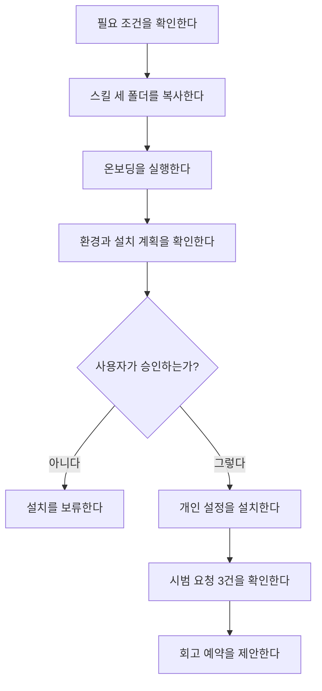
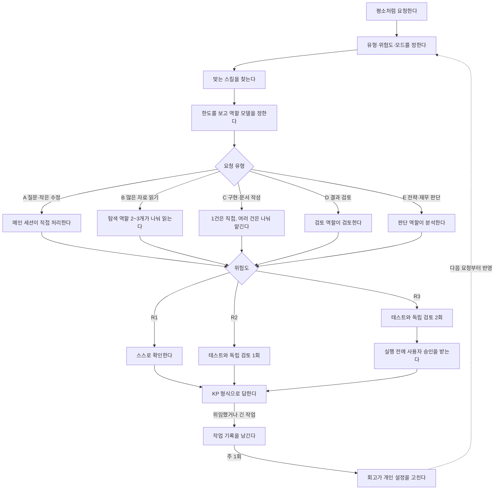

# KP Conductor

**KP Conductor(이하 Conductor)는 Codex에서 요청에 맞는 스킬과 모델을 고르는 진입 절차다.**
한국어로 일하면서 OpenCodex(`ocx`)로 여러 공급사를 쓰는 사용자를 대상으로 한다.

개인 환경에서 만든 알파다.
기본 Codex 대비 효과는 측정하지 않았다.

실업무 가치의 증거를 수집하고 있다.

- **준수도는 모델마다 다르다.** Conductor는 지시문에 기반한다.
- **키워드 매칭은 오분류할 수 있다.** 경로 제안은 실행 기록으로 확인한다.
- **이슈 응답은 약속하지 않는다.** 이슈에는 `cx doctor` 출력을 첨부한다.
  공개 전에 출력의 개인 경로와 계정 정보를 가린다.

## 이렇게 동작한다

스킬이나 모델을 고르지 않고 평소처럼 요청하면 된다.
Conductor가 요청마다 유형과 위험도를 정하고, 맞는 스킬과 역할에 맡긴다.

| 요청 예 | Conductor의 처리 |
|---|---|
| "README 첫 줄이 뭐야?" | 유형 A다. 메인 세션이 바로 답한다. |
| "이 폴더 파일 120개가 각각 뭘 하는지 표로 정리해줘" | 유형 B다. 탐색 역할 2~3개가 구역을 나눠 읽는다. |
| "결제 모듈의 환불 계산을 고쳐줘" | 핵심 모듈 수정이다. 테스트를 돌린 뒤 작성하지 않은 모델이 검토한다. |
| "이 사업계획의 위험을 판단해줘" | 유형 E다. 판단 역할이 본분석을 맡고 메인 세션이 통합한다. |
| "이제 배포해줘" | R3다. 테스트와 독립 검토 2회 뒤에 사용자 승인을 받는다. |

답은 한국어 출력 규칙(Korean Protocol)에 맞춰 쓴다.
비교는 표로, 흐름은 도식으로 보여준다.

작업 기록은 주간 회고에 쓰인다.
회고는 자주 틀린 배정과 놓친 스킬을 찾아 내 개인 설정을 고쳐 나간다.

위 표는 Conductor 규칙이 정한 처리다.
실제 동작은 모델의 지시 준수도에 따라 달라질 수 있다.

## 시작 흐름



## 사용 흐름

설치 뒤에는 요청 하나가 아래 순서로 처리된다.
사용자는 맨 위의 요청만 하면 된다.



독립 검토는 작업을 만들지 않은 모델이 맡는다.
위험도별 세부 예외는 [SKILL.md](skills/kp-conductor/SKILL.md)의 검증 절을 따른다.

회고는 기본값에서 변경 제안만 남긴다.
`retro.apply=notify`로 바꾸면 일부 변경을 바로 적용한다.

## 필요 조건

| 도구 | 조건 | 역할 |
|---|---|---|
| Codex | 앱이나 CLI를 설치한다. | 스킬과 서브에이전트를 실행한다. |
| [OpenCodex](https://github.com/lidge-jun/opencodex) | `ocx`와 연결 가능한 프록시를 준비한다. | 여러 공급사의 모델을 연결한다. |
| 공급사 | 2개 이상 공급사를 연결한다. | 작업 모델과 검토 모델을 선택한다. |
| Python | Python 3을 설치한다. | Conductor 명령을 실행한다. |
| Git | 저장소를 복제할 수 있게 준비한다. | 설치 파일을 가져온다. |

온보딩은 필수 도구가 없으면 설치 안내만 하고 멈춘다.
모델 이용료는 각 공급사의 계정과 요금제를 따른다.

상태를 바꾸는 명령은 macOS·Linux의 파일 잠금을 쓴다.
Windows는 지원하지 않는다.

유료 계정이 필요한 선택은 실행 전에 안내한다.

## 설치

1. **이 저장소를 복제한다.**

   ```sh
   git clone https://github.com/project820/kp-conductor.git
   cd kp-conductor
   ```

2. **스킬 세 폴더를 복사한다.**
   같은 이름의 설치 폴더가 있으면 먼저 백업한다.

   기존 폴더가 있는 상태에서 아래 복사 명령을 실행하지 않는다.

   `~/.agents/skills/korean-protocol`이 이미 있으면 마지막 줄은 실행하지 않는다.
   같은 이름의 스킬이 두 곳에 있으면 어느 사본을 읽을지 흔들린다.

   ```sh
   mkdir -p ~/.codex/skills
   cp -R skills/kp-conductor ~/.codex/skills/kp-conductor
   cp -R skills/kp-conductor-onboard ~/.codex/skills/kp-conductor-onboard
   cp -R skills/korean-protocol ~/.codex/skills/korean-protocol
   ```

3. **Codex의 새 세션에서 온보딩을 호출한다.**

   ```text
   $kp-conductor-onboard
   ```

이후 명령에서 `cx`는 아래 함수로 정의해 사용한다.
함수는 현재 셸에서만 유지된다.

```sh
cx() { python3 ~/.codex/skills/kp-conductor/scripts/conductor.py "$@"; }
```

## 온보딩의 변경과 전송

온보딩은 설치된 스킬의 이름과 설명을 탐지한다.
스킬 본문을 읽어 지도에 연결하지 않는다.

탐지한 설명을 기본 경로 범주에 연결해 개인 지도를 만든다.

| 단계 | 내용 | 쓰기 시점 |
|---|---|---|
| 탐지 | 모델과 한도, 진입 충돌 근거를 확인한다. | 읽기만 수행한다. |
| 계획 | 경로 지도와 모델 역할을 제안한다. | 로컬 계획 파일을 만든다. |
| 검토 | 기본은 차상위 작성과 최상위 전체 검토 1회다. | 전송 동의 뒤 검토 모델을 호출한다. |
| 적용 | 개인 설정과 역할 파일을 만든다. | 최종 계획 승인 뒤 적용한다. |
| 진입 | 선택하면 전역 `AGENTS.md`에 블록을 넣는다. | 승인된 계획의 진입 선택을 따른다. |
| 시범 | 요청 3건의 실제 동작을 확인한다. | 실행 기록으로 준수 여부를 판정한다. |

현재 Codex 세션에는 읽은 환경 자료가 모델 문맥으로 들어간다.
최상위 검토를 선택하면 전역 `AGENTS.md`가 해당 공급사로 전송된다.

탐지한 스킬 목록과 설치 계획도 함께 전송된다.
온보딩은 공급사와 모델을 표시하고 예/아니오 동의를 받는다.

기존 진입이 탐지되면 근거를 인용해 설명한다.
사용자가 `agents_md` 또는 `none`을 고른다.

`none`이면 매 세션에서 `$kp-conductor`를 명시해 사용한다.

최상위 한도가 바닥났거나 호출이 실패하면 임시 계획을 제시한다.
진입 충돌이 있으면 임시 설치는 `entry=none`을 사용한다.

등급표 밖 모델은 자동 배정하지 않는다.
최상위 모델의 온보딩 우위는 아직 측정 전 가설이다.

## 개인 설정과 엔진

엔진이 같은 자동차라도 운전자마다 시트 위치는 다르다.
Conductor의 분류 절차는 엔진이고 개인 경로 지도는 시트 설정에 해당한다.

| 구분 | 위치 | 내용 |
|---|---|---|
| 엔진 | `~/.codex/skills/kp-conductor/` | 분류 규칙과 명령을 담는다. |
| 기본 틀 | 엔진의 `references/` | 경로 범주와 등급표를 제공한다. |
| 개인 설정 | `<state>/local/` | 경로 지도와 역할 배정을 담는다. |
| 기록 | `<state>/` | 실행 기록과 회고 제안을 담는다. |

`<state>`는 `CONDUCTOR_HOME`을 사용한다.
환경 변수가 없으면 `~/.codex/kp-conductor`를 사용한다.

개인 설정과 기록은 공개 저장소에 넣지 않는다.

## 회고

회고는 개인 설정만 고친다.
기본 `retro.apply=propose`에서는 변경을 제안 파일로만 남긴다.

엔진 문제는 `<state>/proposals/upstream-<날짜>.md`에 제안으로 남긴다.
회고 결과를 외부로 자동 전송하지 않는다.

Codex 앱의 자동화 도구가 있으면 주 1회 예약을 제안한다.
예약은 사용자 동의를 받은 뒤 생성한다.

도구가 없으면 `cx status`의 `retro: due`를 실행 계기로 사용한다.

엔진을 다른 컴퓨터에서 배포받기만 하는 보조 컴퓨터는 회고를 끈다.
`cx settings set retro.apply off`를 실행하면 `cx status`가 `retro: off`를 보인다.
`cx retro`도 실행을 거절한다.

개인 설정을 고치기 전에는 `cx overlay backup`으로 받은 ID를 적는다.
고친 뒤에는 `cx overlay verify --id <id>`를 실행한다.

검사가 실패하면 그 ID의 백업으로 복구하고 다시 검사한다.

`cx backup`의 백업에는 `config.toml` 사본이 들어간다.
비밀값이 있을 수 있으므로 백업 폴더를 공유하지 않는다.

## 스킬 점검과 제안

주간 회고는 설치한 스킬도 점검한다.
기본 설정(`retro.apply=propose`)에서는 모든 변경이 제안으로 남는다.

| 점검 | 명령 | 결과 |
|---|---|---|
| 사용 빈도 | `cx skills-audit` | 30일간 안 쓰고 고치지도 않은 외부 스킬을 평가 대상으로 고른다. |
| 원본 갱신 | `cx skills-audit --remote` | 원본의 최신 커밋이 설치본과 다르면 갱신 후보로 표시한다. |
| 부족한 스킬 | `cx skills-suggest` | 켜진 스킬이 없는 작업 범주를 찾는다. 성과가 낮은 스킬도 찾는다. |
| KP 새 버전 | `cx kp status --remote` | 포함한 KP 사본보다 새 릴리스가 있는지 확인한다. |

도태된 스킬은 지우지 않고 끄는 것이 기본이다.
기본 설정에서는 이 끄기도 제안으로 남는다. 끈 스킬은 `cx skills on`으로 다시 켠다.

사용자가 삭제를 승인한 스킬만 지운다.
복사로 설치한 스킬은 `<state>/backups/`에 사본을 남긴다. 링크로 설치한 스킬은 링크만 지우고 원본은 둔다.

```sh
cx skills off <스킬>
cx skills delete <스킬> --dry-run
cx skills delete <스킬> --yes
```

Codex 기본 스킬과 플러그인 스킬, Conductor와 KP는 지우지 않는다.
부족한 스킬의 설치는 원본 안내를 따르며 사용자 동의를 받은 뒤 한다.

## 엔진 관리자(maintainer) 모드

엔진 저장소를 직접 고치는 사람을 위한 설정이다.
일반 사용자에게는 필요 없다.

`<state>/local/settings.json`에 `maintainer` 항목을 직접 적는다.
`retro.apply=notify`이면 회고가 엔진 개선을 로컬 저장소에 커밋한다.

테스트와 독립 검토 2회를 통과한 커밋만 이 컴퓨터와 등록한 원격 컴퓨터에 설치한다.
기본값 `propose`에서는 엔진 변경도 제안 파일로만 남긴다.

```sh
cx maintainer status
cx maintainer install
cx maintainer deploy --host <name>
```

GitHub push는 회고가 하지 않고, 보고에 승인 요청을 남긴다.
설정 형식과 절차는 [retrospective.md](skills/kp-conductor/references/retrospective.md)의 "maintainer 모드" 절을 따른다.

## 상태 확인과 제거

`cx status`는 온보딩과 진입 블록 상태를 보여준다.
`cx doctor`는 의존성과 역할 설정을 검사한다.

```sh
cx status
cx doctor
cx uninstall --dry-run
cx uninstall
```

`cx uninstall`은 진입 블록과 생성된 역할 등록을 제거한다.
`cx skills off`로 끈 스킬도 다시 켠다.
개인 상태 폴더는 보존하고 경로를 알려준다.

복사한 스킬 폴더의 삭제는 별도로 선택한다.

## 버전과 업데이트

설치한 버전은 `cx --version`으로 확인한다.
버전별 변경은 [CHANGELOG.md](CHANGELOG.md)와 [릴리스 목록](https://github.com/project820/kp-conductor/releases)에 있다.
버전 규칙은 [RELEASING.md](RELEASING.md)를 따른다.

새 버전으로 바꿀 때는 설치한 엔진 폴더를 백업한 뒤 다시 복사한다.
개인 설정(`<state>/local/`)은 그대로 남는다.

```sh
cd kp-conductor
git pull
backup=~/.codex/kp-conductor/backups/engine-$(date +%Y%m%d-%H%M%S)
mkdir -p "$backup"
mv ~/.codex/skills/kp-conductor ~/.codex/skills/kp-conductor-onboard "$backup"/
cp -R skills/kp-conductor ~/.codex/skills/kp-conductor
cp -R skills/kp-conductor-onboard ~/.codex/skills/kp-conductor-onboard
cx status
```

`cx status`에 `entry: outdated`가 나오면 `cx entry install`을 실행한다.
그다음 `cx doctor`로 확인한다.

포함한 Korean Protocol은 엔진과 따로 갱신한다.
`cx kp status --remote`로 새 릴리스를 확인하고 `cx kp update`로 바꾼다.

```sh
cx kp status --remote
cx kp update --dry-run
cx kp update
```

이전 사본은 `<state>/backups/kp-<시각>/`에 남는다.
`~/.agents/skills/korean-protocol`에 따로 설치한 KP는 그 저장소의 방법으로 갱신한다.

## 웹 검색 사이드카

OpenCodex를 거치는 모델은 Codex 내장 `web_search`를 검색 사이드카로 실행한다.
사이드카의 백엔드와 모델은 `ocx agent sidecar web`으로 정한다.

Anthropic 사이드카는 권하지 않는다.
Anthropic 웹 검색은 검색 결과의 암호화 본문을 응답 스트림에 함께 보낸다.
그래서 검색을 두 번 이상 하면 OpenCodex의 64KB 응답 상한을 넘는다.

OpenCodex v2.98.0부터 상한을 넘은 검색은 받은 답과 관계없이 실패로 처리한다.
Anthropic 사이드카에는 요청당 전송 한도(`send_budget_exhausted`)도 걸린다.

검색 사이드카에는 경량 모델을 권한다.

| 백엔드 | 모델 예 | 특징 |
|---|---|---|
| `openai` | `gpt-6.1-terra` | 1순위다. Luna보다 조금 느리지만 출처를 더 많이 가져온다 |
| `openai` | `gpt-6-luna` | Terra보다 조금 빠르고 출처가 적다 |
| `gemini` | `gemini-3.8-flash` | 빠르고 출처가 많아 좋은 선택이다. Antigravity 계정이 필요하다 |

OpenAI 경로는 1MB 응답 상한을 쓰고 전송 한도가 걸리지 않는다.
대신 Codex의 ChatGPT 로그인을 넘겨받아야 한다.

Gemini 경로는 단기 한도를 다른 Gemini 모델과 함께 쓴다.
응답 상한은 64KB라서 큰 검색 답은 실패할 수 있다.

```sh
ocx agent sidecar web --backend openai --model gpt-6.1-terra --reasoning low
```

`cx doctor`와 `cx status`가 요청 경로별 사이드카를 보여 준다.
Claude Code 요청은 `claudeCode.webSearchSidecar` 설정이 전역 설정을 덮어쓴다.

## 권장 도구

온보딩은 권장 도구를 바로 설치하지 않는다.
먼저 같은 일을 하는 도구가 이미 있는지 찾는다.

- 이미 있는 도구(스킬, 플러그인, MCP)가 있으면 그 도구를 경로 지도에 연결한다.
- 없으면 원본 저장소와 설치 명령을 안내하고, 동의를 받은 뒤 설치한다.

목록은 [recommended-skills.json](skills/kp-conductor/references/recommended-skills.json)에 있다.
이 저장소는 권장 도구의 파일을 포함하지 않는다.

| 도구 | 용도 | 라이선스 | 설치 |
|---|---|---|---|
| [superpowers](https://github.com/obra/superpowers) | 테스트·디버깅·코드 검토 절차 | MIT | Codex 공식 플러그인 마켓플레이스 |
| [StyleGallery](https://github.com/changeroa/StyleGallery) | UI/UX 설계 근거 조회 | MIT(코드), CC BY 4.0(문서) | `npm install --global stylegallery@0.1.19` 뒤 `stylegallery setup --agent codex` |
| [unslop](https://github.com/heydamir/unslop) | 화면의 AI 티 제거 | CC BY 4.0 | `$skill-installer install https://github.com/heydamir/unslop/tree/main/skills/unslop` |

StyleGallery는 Node.js 22 이상이 필요하다.
`setup`은 먼저 `--dry-run`으로 바뀔 내용을 확인한다.

Mobbin MCP는 유료 요금제(Pro 이상)에서만 제공된다.
무료 요금제에는 MCP가 없다(2026-11-17 [요금표](https://mobbin.com/pricing) 확인).

미공개 개인 스킬은 권장 목록에 포함하지 않았다.

## 라이선스

Conductor는 [MIT License](LICENSE)로 제공한다.
포함한 Korean Protocol v0.11.1도 MIT다.

KP의 저작권과 허가문은 [별도 LICENSE](skills/korean-protocol/LICENSE)에 보존했다.
고정 출처는 [PINNED.json](skills/korean-protocol/PINNED.json)에 기록했다.

unslop은 CC BY 4.0인 권장 설치 대상이다.
unslop 파일은 이 저장소에 포함하지 않는다.

제3자 범위와 수정 고지는 [NOTICE.md](NOTICE.md)를 확인한다.
