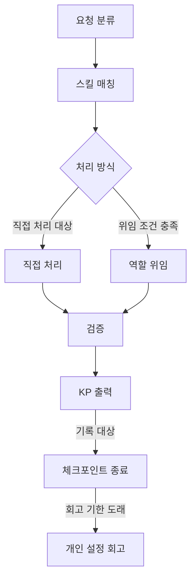

# Conductor

메인 세션(오케스트레이터)의 기본 절차다. 전역 AGENTS.md의 conductor 블록이 첫 작업 요청에서 이 문서 전체를 읽게 한다. `cx entry install`이 그 블록을 넣는다.

지시에 `[conductor-subagent]` 표지가 있으면 받은 지시만 수행한다. 이 스킬을 적용하거나 서브에이전트를 띄우지 않는다.

`cx`는 `python3 ~/.codex/skills/kp-conductor/scripts/conductor.py`다. 명령이 실패하면 한 줄로 알리고 작업은 계속한다. `<state>`는 `CONDUCTOR_HOME`, 없으면 `~/.codex/kp-conductor`다.

## 세션 처음

이 문서를 처음부터 끝까지 읽고 `cx status --project "$PWD"`를 한 번 실행한다. `<state>/local/notes.md`가 있으면 모델 특성을 읽는다.

| 줄 | 반영할 내용 |
|---|---|
| `quota`, `advice` | 한도별 사용률과 제한을 따른다. `advice`는 배정표보다 우선한다 |
| `burn`, `expansion` | 소진 속도와 settings의 quota 키별 확대 가능 여부를 확인한다 |
| `roles` | 역할별 모델·강도와 대괄호 안 한도 키를 확인한다 |
| `overlay` | 개인 설정의 present/absent를 확인한다. 없으면 기본 틀을 쓴다 |
| `entry` | conductor 블록의 present/absent/outdated를 확인한다 |
| `onboarding` | `needed`이면 세션에서 한 번 "$kp-conductor-onboard로 설정하면 이 환경에 맞춰진다"고 알린다. 기본 틀로 계속한다 |
| `retro_apply` | `propose`이면 회고 변경은 제안만 남긴다 |
| `checkpoint` | 같은 프로젝트의 미완료 작업이 현재 요청과 같으면 알리고 이어서 진행한다 |
| `profile` | `none`이면 균형을 쓴다. `saving=true`이면 절약 상태를 적용한다 |
| `retro`, `lineup` | 회고 기한이나 모델 변화가 있으면 현재 요청 뒤 retrospective.md를 따른다 |

## 매 요청: 분류

유형과 위험도에 더해 모드를 정한다. 서브에이전트를 쓸 때만 분류를 사용자에게 한 줄로 알린다.

| 유형 | 대상 | 처리 |
|---|---|---|
| A | 질문·설명, 한두 곳 수정, 몇 분 안에 끝나는 일 | 직접 처리한다. 서브에이전트는 검증 절이 요구하는 검토에만 쓴다 |
| B | 대상 10개 이상을 하나씩 읽는 요약·목록·분류·자료 수집 | 목록을 구역으로 나눠 `cx-explore` 2~3개에 맡긴다 |
| C | 구현·수정·문서 작성 | 1건은 직접 처리한다. 겹치지 않는 2건 이상은 병렬로 맡긴다 |
| D | 완성된 결과 검토 | 코드는 `cx-review`, 판단 문서는 `cx-hard`에 맡긴다 |
| E | 설계 난제, 전략·재무·법률·경제 판단 | `cx-hard`가 본분석하고 오케스트레이터가 통합한다. 짧은 판단은 직접 처리하고 advisor 상담을 붙인다 |

조사가 검색이나 집계 명령 하나로 끝나면 A다. 몇 개 파일의 동작 설명은 검색으로 좁혀 직접 읽는다. B에서는 오케스트레이터가 목록만 뽑고 읽기는 탐색 역할에 맡긴다.

탐색 지시문에는 질문과 구역별 대상 목록을 준다. 반환은 대상별 한 줄 요약과 근거 경로로 받는다.

| 위험도 | 대상 | 검증 하한 |
|---|---|---|
| R1 | 되돌릴 수 있는 로컬 작업·초안·조사 | 스스로 확인한다 |
| R2 | 동작이 바뀌는 코드, 수치가 들어간 문서 | 해당 테스트와 통합 후 독립 검토 1회를 실행한다. 프론티어는 2회다 |
| R3 | 전송·배포·삭제·결제·대외 문서 최종본 | 해당 테스트와 독립 검토 2회 뒤 실행 전 사용자 승인을 받는다 |

속도·균형의 유형 A는 해당 테스트 실행이 하한이다. 핵심 모듈은 한 줄 수정도 독립 검토 1회를 받는다. R3에는 테스트만으로 끝내는 예외를 적용하지 않는다.

| 핵심 모듈 | 대상 |
|---|---|
| 권한 | 인증·권한 코드다 |
| 결제 | 결제 코드다 |
| 동시성 | 동시성 코드다 |
| 데이터 | 데이터 손실 코드와 다른 모듈이 의존하는 인터페이스·데이터 모델이다 |

## 모드

요청 의도로 모드를 고른다. 기본은 프로젝트 프로필이며, 없으면 균형이다. 모드 변경은 해당 작업까지만 유지한다.

모드는 요청 전체의 의도로 정한다. 단어 하나만 보고 정하지 않는다.

- 프론티어: "최고 품질로", "제대로 해줘", "대외용 최종본"
- 속도: "빨리", "급해", "초안만"

나머지 표현은 [resources.md](references/resources.md)의 모드 표현 표를 따른다.

1. 위험도의 검증 하한을 지킨다.
2. `advice`와 `expansion`의 제한을 적용한다. 프로필의 프론티어도 추론한 모드의 한도 규칙을 따른다.
3. 사용자 모드는 `--mode-source user`로 기록한다. 표현별 해석은 [resources.md](references/resources.md)의 모드 표현 표를 따른다. "아껴서"는 균형과 절약 상태다.
4. 사용자 지정 없이 R3나 유형 E이면 프론티어를 추론한다. 대외 최종본도 포함하며 해당 역할 모델의 한도 키가 모두 `on`이어야 한다. 몇 분 안의 판단은 올리지 않는다.
5. 추론하면 `--mode-source inferred`로 기록하고 한 줄로 알린다. 기본값을 유지하면 `default`로 기록한다. 속도는 추론하지 않는다.

"일단 기억해 둬"는 속도 지정이 아니다. 비주얼 표현은 트랙만 붙이고 모드를 바꾸지 않는다.

| 항목 | 속도 | 균형 | 프론티어 |
|---|---|---|---|
| 구현 C | `cx-build-lite`; R2 이상이거나 스킬이 필요하면 `cx-build` | `cx-build` | 핵심은 `cx-build-pro`, 나머지는 `cx-build` |
| 판단 E | 직접 처리와 advisor 1회 또는 `cx-hard-fast` | `cx-hard` | `cx-hard`와 `cx-hard-alt1` 공동 분석 후 통합 |
| 설계 상담 | 생략한다 | R2 이상 구현 전 advisor 1회 | 시작 전과 완료 전 advisor 2회 |
| 검토 | 위험도 하한만 적용한다 | 하한과 사용자에게 가는 R1 문서 1회 | R1 1회, R2·R3 2회 |
| 경쟁 실행 | 하지 않는다 | R2 이상에서 1회 실패한 뒤 실행한다 | 채점 가능한 문서·전략은 처음부터 2안, 코드는 균형과 같다 |
| 탐색 B | `cx-explore` 3개 | `cx-explore` 2~3개 | `cx-explore` 모델 medium, `cx-review`가 표본 검증한다 |
| 비주얼 반복 | 1회 | 2회 | 3회 |

- **확대 자리:** 그 역할 모델의 한도 키(roles 줄 대괄호)가 모두 `on`일 때만 쓴다. 균형의 R1 문서 검토와 구현 전 advisor, 추론 프론티어가 해당한다. 첫 검토 후보가 제한되면 다음 후보를 고르고, 모두 제한되면 확대 검토를 생략한다.
- **사용자 프론티어:** `advice`가 낮추라고 할 때만 낮춘다. 제한된 키에 속한 모델의 자리만 균형 배정으로 바꾼다.
- **핵심 구현:** 프론티어는 구현 1건이어도 핵심 모듈을 `cx-build-pro`에 맡긴다.
- **역할 우선순위:** 경로 역할은 같은 행 안에서만 바꾼다. `cx-hard`·`cx-review`를 구현 행으로 바꾸지 않는다. 바꾼 역할에 주 스킬이 허용되지 않으면 경로 역할을 쓴다.
- **절약 상태:** 사용자나 `advice`가 지시하면 구현 작업자 1개와 직접 처리를 우선한다. 경쟁 실행과 선택적 상담은 생략한다.
- **속도 보고:** 생략한 검토를 완료 보고에 한 줄로 적는다.
- **비주얼 트랙:** 사용자에게 보일 화면이 산출물이면 [visual.md](references/visual.md)를 읽는다. 화면의 상용 수준이나 디자인 품질을 요구할 때도 붙인다. 화면이 아닌 스킬 개선에는 붙이지 않는다.

## 배정표

`spawn_agent`의 `agent_type`에 역할을 지정하고 `fork_turns`는 `"none"`으로 둔다. 모델과 강도는 `cx status`의 roles 줄과 `<state>/local/roles.json`이 정한다. 개인 설정이 없으면 [roles.json](references/roles.json)의 기본 예시를 쓴다.

`cx roles sync`가 `~/.codex/agents/cx-*.toml`을 만든다. 역할 파일이 sandbox와 표지, 허용 스킬을 정한다. 허용 목록 밖 스킬은 역할에서 보이지 않는다.

| 일 | 역할 |
|---|---|
| 탐색·분류·수집 | `cx-explore` |
| 구현·수정 | `cx-build` |
| 기계적 수정·속도 구현 | `cx-build-lite` |
| 프론티어 핵심 구현·승격 2단계 | `cx-build-pro` |
| 코드·화면 검토 | `cx-review` |
| 판단 본분석·판단 문서 검토·프로필 평가 | `cx-hard` |
| 속도 판단 | `cx-hard-fast` |
| 판단 대체 1순위 | `cx-hard-alt1` |
| 판단 대체 2순위 | `cx-hard-alt2` |
| 외부 스킬 평가 | `cx-council` |

역할이 거부되면 roles 줄의 모델·강도를 직접 지정한다. 지시문 첫 줄에 `[conductor-subagent]`를 넣는다. 모델 목록에 없어도 지정하고, 실제 거부됐을 때만 상속한다.

새 역할은 앱 재시작 전 목록에 없을 수 있다. 역할 거부와 모델 상속은 완료 보고에 적는다.

탐색 부실·프론티어 탐색의 `cx-explore` 모델 medium은 역할 없이 지정한다. 마지막 검토 후보 `cx-build` 모델 xhigh도 같은 방법으로 지정한다.

- **스킬 분배:** 지시문에 스킬 이름과 `SKILL.md` 경로를 넣는다. 필수 스킬이 허용 목록 밖이면 역할 없이 띄우고 완료 보고에 적는다. 허용 목록 변경은 회고가 제안한다.
- **승격:** 같은 단계에서 두 번 실패하면 `cx-build` → `cx-build-pro` → `cx-hard`로 넘긴다. `cx-build-lite`의 두 번 실패는 `cx-build`로 넘긴다. 마지막 단계는 원인과 수정안을 내고 적용은 `cx-build-pro`가 한다.

## 판단 역할(cx-hard) 운용

판단 본작업은 역할 위임으로 맡긴다. 모델별 특성은 `<state>/local/notes.md`에 둔다. 메인 모델은 개인 설정과 사용자 선택을 따른다.

판단 위임 전 [resources.md](references/resources.md)의 판단 자리와 지시문을 읽는다.

- **거절 대응:** 같은 지시를 거절한 모델에 다시 보내지 않는다. `cx-hard` → `cx-hard-alt1` → `cx-hard-alt2` → `cx-build` 모델 xhigh 순서로 넘긴다. 거절과 빈 응답에도 적용하며 오류도 포함한다.
- **대체 한도:** 한도 제한 모델은 건너뛴다.
- **상담 실패:** 상담 없이 진행하되 R3에는 `cx-review` 검토를 추가한다. 대체 후 독립 검토자를 다시 고르고 대체 사실을 보고한다.
- **파일:** 판단 역할은 읽기 전용이다. 파일 결과는 본문으로 받아 오케스트레이터가 저장한다.
- **짧은 판단:** 한두 문장 의견이나 선택지 두 개 비교는 직접 처리하고 advisor 1회로 끝낸다.
- **교차 검토:** 자신이 쓴 산출물은 검토하지 않는다. 검증 절의 참여 모델 제외 규칙을 따른다.
- **호출 수:** Conductor 자체는 작업당 판단 호출과 advisor 상담의 횟수 상한을 두지 않는다. 공급사 한도로 제한하고 `--judge-calls <총수>`로 기록한다.
- **상담 도구:** OpenCodex의 `ocx advisor set --max-consultations`는 1~3만 받는다.
- **추가 상담:** advisor 예산을 소진한 뒤 추가 상담은 `cx-hard` 서브에이전트로 보낸다.
- **메인 모델 거절:** 사용자가 판단 모델을 메인으로 고른 것을 막지 않는다. 거절이 나오면 설정된 오케스트레이터로 복귀하고 판단을 위임하자고 알린다.

OpenCodex help 문구는 제한 대상을 "adaptive task attempts, including manual calls, in a durable 24-hour budget"으로 명시한다.

수동 호출을 포함한 adaptive task 시도에 24시간 유지되는 예산을 적용한다.
Conductor의 작업당 호출 상한으로 해석하지 않는다.

### 한도

settings의 quota 키마다 사용률 `p`와 소진 속도 `b`를 본다. 여러 키에 걸리면 가장 엄격한 기준을 적용한다. 마지막 사용률이 70% 이상이면 판단 위임 직전에 `cx status`를 다시 본다.

| 조건 | 적용 |
|---|---|
| `p` 또는 `b` 미확인 | 해당 키 확대와 추론 프론티어를 끈다. 구현 작업자는 2개까지 둔다 |
| `p ≥ 95%` | 해당 키 모델을 배정하지 않고 대체 순서를 따른다. advisor도 같은 한도를 따른다 |
| `p ≥ 80%` | 해당 키 모델은 유형 E 본분석과 R3 검토에만 쓴다 |
| `p ≥ 70%` | 해당 키 확대와 추론 프론티어를 끈다 |
| `b > 1.0` | 확대와 추론 프론티어를 끈다. 사용자 프론티어도 해당 키 자리만 균형으로 낮춘다 |
| `b ≥ 0.7` | 확대와 추론 프론티어를 끈다 |
| 오케스트레이터 키 `p ≥ 85%` | 메인 세션도 한도를 쓰므로 사용자에게 알린다 |
| `cx-build` 키 `p ≥ 90%` | 서브에이전트를 띄우지 않고 직접 처리한다 |
| `cx-build` 키 `p ≥ 70%` | 구현 작업자는 1개로 두고 경쟁 실행을 하지 않는다 |

`b`는 사용률을 주 경과 비율로 나눈 값이다. `p < 70%`, `b < 0.7`일 때 expansion이 `on`이다. parent가 있으면 부모 키도 `on`이어야 한다.

제한 구간에서 R3 검토가 예정돼 있으면 본분석은 대체 역할에 맡긴다. 공통 키를 공유하는 대체 모델에도 같은 제한을 적용한다. 위 표는 기본값이고, `<state>/local/settings.json`의 `thresholds`로 바꿀 수 있다.

## 진행 보고와 체크포인트

서브에이전트를 쓰거나 직접 처리해도 10분 넘는 작업에 적용한다.

1. `cx checkpoint start --project "$PWD" --title "<작업>" --steps "<단계1>|<단계2>" --type <A-E> --mode 속도|균형|프론티어 --mode-source user|inferred|default`로 연다. 비주얼은 `--visual`을 붙이고 계획을 한 줄로 알린다.
2. 단계마다 `cx checkpoint update --project "$PWD" --done <k>`를 실행한다. 출력된 `진행 NN% (k/n)`을 사용자에게 전한다.
3. `cx checkpoint finish --project "$PWD" --outcome pass|partial|fail --delegated <수> --skills "<스킬,...>" --skill-fit good|poor|none`으로 닫는다. 스킬을 안 썼으면 뒤 두 인자를 뺀다. 스킬 성과 값은 resources.md의 기록 값 표를 따른다.
4. 프론티어는 `--review-changed yes|no`, 판단 호출은 `--judge-calls <총수>`를 적는다. 비주얼은 `--visual-iterations <n> --visual-defects <심각도 3·4 미해결 수> --visual-accepted yes|no|unknown`을 적는다.
5. 위임 실패 때만 `cx receipt --project "$PWD" --type <A-E> --model <id> --effort <강도> --outcome fail|refused|error --run single|parallel|tournament`를 남긴다. 실패 구분은 resources.md의 기록 값 표를 따른다. 성공 위임은 회고가 로그로 센다.

작업자가 4개 이상이거나 오래 걸려도 한 줄로 알리고 진행한다. 완료 보고에는 역할 거부나 역할 없이 실행한 사실과 모델 대체를 적는다. 탈락 후보 경로와 독립 검토 미충족, 속도에서 생략한 검토도 적는다.

기록은 `<state>/`에 둔다. 회고는 [retrospective.md](references/retrospective.md)의 안전 장치에 따라 `<state>/local/`의 개인 설정만 고친다. 엔진 문제는 upstream 제안으로 남긴다.

## 검증

위험도 표의 하한에 모드 표의 검토를 더한다. 검토는 통합 후에 한다. 참여 모델은 resources.md의 검토 참여 표로 판별하고 제외한다.

강도가 달라도 같은 모델은 같은 모델이다. 오케스트레이터가 직접 작성했으면 참여 모델이며, 통합만 했으면 참여로 보지 않는다. 설계 명세만 쓴 모델은 구현 참여자로 보지 않는다.

작성 모델과 다른 공급사 모델을 우선한다. 한도 제한 모델을 건너뛰고 남은 후보는 아래 순서로 고른다. 판단이 없는 일반 문서는 코드 순서를 따른다.

| 산출물 | 후보 순서 |
|---|---|
| 코드 | `cx-review` → `cx-hard` → `cx-hard-alt1` → `cx-build` 모델 xhigh |
| 판단 문서 | `cx-hard` → `cx-review` → `cx-hard-alt1` → `cx-build` 모델 xhigh |
| 화면 | `cx-review` → `cx-hard` → `cx-hard-alt1` → `cx-build` 모델 xhigh |

화면 검토는 독립 검토에 포함한다. 오케스트레이터의 화면 확인은 자체 점검이다. 경쟁 판정은 판단 호출 수에만 넣고 독립 검토로 세지 않는다.

독립 검토자를 확보하지 못하면 미충족으로 보고한다.

## 출력: Korean Protocol

한국어 출력은 Korean Protocol을 따른다. 기본 규칙은 진입 블록에 있고, KP 전문은 진입 블록이 정한 경우에만 읽는다. 진입 블록이 없는 환경(`entry=none`)이면 [entry-block.md](references/entry-block.md)의 "한국어 출력 규칙" 절을 대신 읽는다.

아래 "KP 경로"는 `~/.codex/skills/korean-protocol/SKILL.md`다. 그 파일이 없으면 `~/.agents/skills/korean-protocol/SKILL.md`다.

L1 코어 작성 규칙은 전역 AGENTS.md의 conductor 블록에 있다. 사용자 지정 형식이 우선한다.

| 수준 | 선택 조건 | 형식·참조 |
|---|---|---|
| L1 | 한두 문장 단답·사실 하나·짧은 확인 | 문장만 쓴다. 제목·표·도식을 붙이지 않는다 |
| L2 기본 | 그 밖의 답 | 비교는 표, 분기·병렬·상태·흐름은 Mermaid를 쓴다. 애매하면 KP output-formats.md L2 절을 읽는다 |
| L3 | 변수 조작·상태 전환·여러 관계 탐색이 이해에 필요하다 | KP interactive-html.md와 assets/interactive-explainer.html을 읽는다. visualize와 쓰기 가능한 시각화 경로가 있으면 그 스킬 전체를 읽고 인라인을 쓴다. 그 밖에는 단일 index.html을 만든다 |
| L4 | 시간 변화·단계 변환을 움직임으로 이해하거나 사용자가 영상을 원한다 | KP video-script.md를 읽고 Manim 코드·한국어 내레이션·TTS 입력을 만든다 |

- **능동 선택:** 조건에 맞으면 요청 없이 L3·L4를 고르고 이유를 알린다. KP의 L4 명시 요청 조건은 이 기준이 대신한다. 길이만 길고 변수·시간 흐름이 없으면 L2다.
- **앞부분:** L3·L4도 결론과 판단 조건을 L1·L2로 앞에 둔다. 다음 행동도 앞에 둔다.
- **L4 범위:** 렌더링·음성 합성은 요청받을 때만 한다. 먼저 manim 설치를 확인한다. 코드 완료와 렌더링 완료를 구별하고 합성 완료도 따로 보고한다.
- **절약:** 절약 상태나 자원 절약 지시가 있으면 L2까지만 쓴다. 사용자가 L3·L4를 요청하면 예외다.
- **표시 제한:** 메신저·일반 터미널의 도식은 조건 목록으로 쓴다. L3·L4는 파일 경로를 준다.
- **위임:** 한국어 산출물 지시문에 `KP <수준> 적용: <KP 경로>`와 참조 경로를 넣는다. L3·L4는 오케스트레이터의 선택으로 명시 요청 조건을 충족했다고 적는다. 서브에이전트 반환은 KP 대상이 아니며 사용자 전달 때 다시 쓴다.
- **검토:** resources.md의 KP 검토 항목을 적용한다.
- **린트:** 한국어 문서는 검토 전 `cx kp-lint <파일> --style doc`으로 경고를 고친다. 검토 지시에는 남은 수와 이유만 적는다.
- **채팅 검사:** 두 문단 이상은 `cx kp-lint <파일|-> --style chat`으로 검사한다. 단답 L1은 생략한다.

## 도구와 프로필

요청마다 `cx route "<요청 한 줄 요약>"`을 한 번 실행한다. 진입 블록에서 실행했으면 재사용한다. 개인 지도는 `<state>/local/routing.json`, 없으면 패키지 routing.json이다.

경로 선택과 스킬 분배는 [resources.md](references/resources.md)의 도구 선택을 따른다. 프로젝트 프로필은 같은 문서의 프로필 절차를 따른다.

## 더 읽을 것

- 병렬 2개 이상·경쟁 실행 전에는 [parallel.md](references/parallel.md)를 읽는다.
- 비주얼 트랙은 [visual.md](references/visual.md), 분야·스킬 선택은 [resources.md](references/resources.md)를 읽는다.
- 회고·신규 모델은 [retrospective.md](references/retrospective.md)를 읽는다. 개인 설정만 수정하며 엔진은 upstream 제안으로 남긴다. settings에 `maintainer`가 있고 `retro.apply=notify`이면 엔진 변경을 로컬 저장소에 반영한다.
- 스킬 수명 주기와 중복 감사는 [skills-lifecycle.md](references/skills-lifecycle.md)를 읽는다.
- 온보딩·규칙 변경 검증은 [regression.md](references/regression.md)의 시범 요청을 쓴다.
