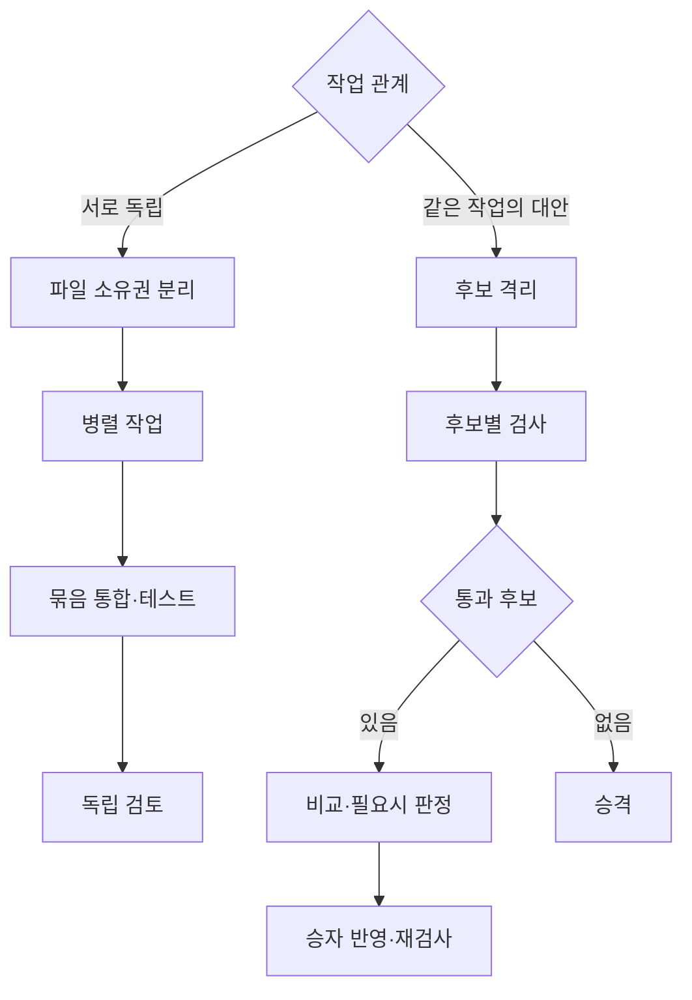

# 병렬 실행과 경쟁 실행

작업자 수보다 수정 범위의 분리와 통합 시간이 속도를 결정한다. 구현 1건의 위임은 직접 처리보다 빨라지지 않는다. 경쟁 실행은 같은 작업의 여러 결과에서 승자를 고른다.

## 병렬 실행

1. 수정 파일이 겹치지 않는 작업이 2건 이상일 때만 병렬로 실행한다.
2. 띄우기 전에 인터페이스와 타입을 확정한다. 파일 소유권도 확정한다.
3. 파일당 작성자는 1명이다. 아래 공통 파일은 오케스트레이터만 수정한다.
4. 아래 공통 작업은 한 번에 한 에이전트만 수행한다. 작업자는 자기 범위의 테스트만 실행한다.
5. 의존 순서에 따라 묶음 단위로 병렬 실행한다. 통합과 전체 테스트는 묶음마다 한 번 한다.
6. 통합 후에 검토한다. 독립 검토자와 횟수는 SKILL.md의 검증·모드 규칙을 따른다.
7. 다음 단계를 막는 작업은 오케스트레이터가 직접 한다. 기다리는 동안 통합 테스트나 문서를 준비한다.
8. 읽기 전용 탐색(cx-explore)은 2~3개 동시 실행을 언제나 허용한다.
9. 같은 실패를 두 에이전트가 동시에 고치지 않는다.

| 공통 파일 | 작성자 |
|---|---|
| lockfile | 오케스트레이터만 수정한다 |
| 설정 | 오케스트레이터만 수정한다 |
| 스키마 | 오케스트레이터만 수정한다 |
| 마이그레이션 | 오케스트레이터만 수정한다 |
| 라우트 목록 | 오케스트레이터만 수정한다 |

| 공통 작업 | 동시 실행 |
|---|---|
| 전체 빌드 | 한 에이전트만 실행한다 |
| 전체 테스트 | 한 에이전트만 실행한다 |
| 개발 서버 | 한 에이전트만 실행한다 |
| 의존성 설치 | 한 에이전트만 실행한다 |
| git 조작 | 한 에이전트만 실행한다 |

### 작업자 지시문

여섯 항목만 준다.

1. 목표는 끝났을 때 참이어야 하는 조건으로 쓴다.
2. 소유 파일은 수정해도 되는 파일로 정한다.
3. 금지 파일은 읽기만 하게 한다. 다른 에이전트의 작업 중에는 남의 변경을 되돌리지 말라고 적는다.
4. 계약은 지켜야 하는 인터페이스와 타입으로 정한다.
5. 완료 판정 명령은 실행해서 통과해야 하는 명령으로 정한다.
6. 반환은 변경 요약 5줄 이내와 실행한 명령·결과를 받는다. 미해결 사항도 받는다. 긴 결과물은 파일 경로만 반환하게 한다.

## 경쟁 실행

아래 조건을 모두 만족할 때만 실행한다.

- 완료 판정 명령이나 채점 기준으로 객관적 비교가 가능하다.
- 접근법에 따라 결과가 달라진다. 이름 변경이나 설정값 수정처럼 답이 하나인 작업은 제외한다.
- 모드 표의 경쟁 조건에 해당하거나 사용자가 경쟁·여러 안을 요청했다.
- cx status의 advice에 경쟁 실행 금지 지시가 없다.

후보는 2개이며 구현 작업자 수에 포함한다. 후보마다 접근법 힌트를 다르게 준다.

| 힌트 | 접근 |
|---|---|
| 최소 변경 | 수정 범위를 줄인다 |
| 기존 구조 재사용 | 기존 요소를 재사용한다 |
| 새 모듈 분리 | 경계를 분리한다 |

문서나 전략 또는 재무 경쟁은 cx-hard와 cx-build가 후보를 하나씩 낸다. 읽기 전용 역할의 본문 결과는 오케스트레이터가 후보 폴더에 저장한다. 코드 후보는 cx-build로 둔다.

### 격리

- **git 저장소:** 후보마다 worktree를 만든다. 후보는 자기 worktree에서만 작업하고 커밋하지 않는다.

  `git worktree add ~/.codex/worktrees/kp-conductor/<체크포인트 id>/c<번호> -b kp-conductor/<체크포인트 id>-c<번호>`

- **그 밖의 폴더·문서:** 후보 결과는 `<state>/runs/<프로젝트>/<체크포인트 id>-c<번호>/`에 쓴다. 프로젝트 폴더는 건드리지 않는다.

### 선별

1. 각 후보에서 완료 판정 명령을 실행한다. 실패 후보는 탈락한다.
2. 통과 후보가 둘 이상이면 변경을 비교한다. 우선순위는 아래 표를 따른다.
3. R3이거나 우열이 불분명하면 판정 역할에 맡긴다. 후보 작성 모델과 다른 공급사를 우선한다. 실제 참여 모델을 확인하고 아래 역할을 고른다.
4. 판정자에게 후보 순서를 바꿔 두 번 묻는다. 점수마다 근거 문장을 받는다.
5. 판정이 엇갈리면 오케스트레이터가 근거를 비교해 정한다. 엇갈린 사실을 완료 보고에 적는다.
6. 테스트 없는 문서·문안은 설치된 채점 도구의 루브릭 점수도 비교한다. 점수만으로 확정하지 않는다.
7. 전부 실패하면 승격 순서를 따른다.

| 순위 | 비교 기준 |
|---|---|
| 1 | 요구 충족을 비교한다 |
| 2 | 변경 크기를 비교한다 |
| 3 | 기존 관례와의 일치를 비교한다 |

| 후보 | 판정 역할 |
|---|---|
| 코드 후보가 모두 cx-build다 | cx-hard가 판정한다 |
| 문서 후보가 cx-hard와 cx-build다 | 후보를 내지 않은 cx-review 모델이 판정한다 |

판정자도 후보 작성에 참여했다면 다른 독립 모델을 고른다. 판단 역할이 한도로 제한되면 SKILL.md의 대체 순서를 따른다.

### 반영과 정리

- **승자 반영:** 작업 폴더에 적용한다. git이면 승자 worktree의 diff를 적용하고 전체 테스트를 다시 실행한다.
- **후보 보존:** 탈락 후보의 worktree와 결과 폴더는 지우지 않는다. 완료 보고에 경로를 적는다. 사용자 정리 요청 때만 worktree와 브랜치를 삭제한다.
- **영수증:** 후보마다 `--run tournament`로 남긴다. 탈락 후보는 `--outcome fail`로 적는다.
