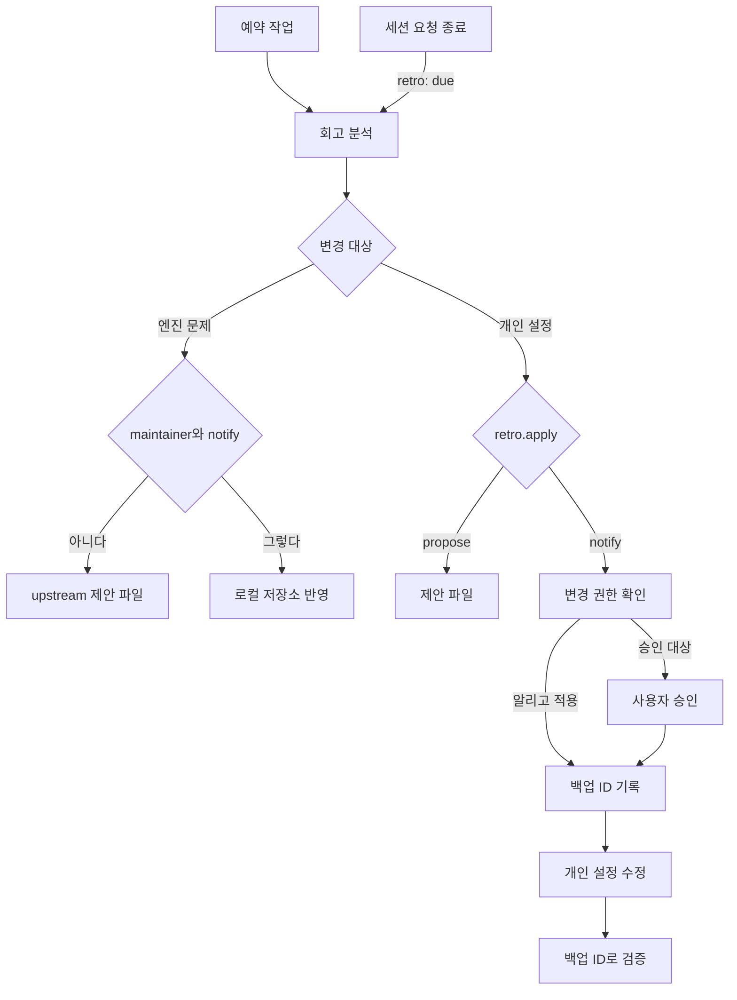

# 회고와 개인 설정 갱신

회고는 `<state>/local/`의 개인 설정만 고친다. 설치된 엔진의 SKILL.md·references·scripts는 고치지 않는다. `<state>`는 `CONDUCTOR_HOME`, 없으면 `~/.codex/kp-conductor`다.

예외는 `settings.json`에 `maintainer`가 있는 경우다. 이때는 아래 "maintainer 모드" 절도 따른다.



## 실행 계기

1. Codex 앱 예약 작업이 실행한다. 온보딩이 사용자 동의를 받아 예약을 만든다.
2. `cx status`에 `retro: due`가 나오면 세션 요청을 끝낸 뒤 실행한다.

주기는 7일이다. 명시적인 회고 요청도 이 절차로 처리한다. 모델 변화는 현재 요청을 끝낸 뒤 신규 모델 절차로 처리한다.

`retro.apply=off`인 컴퓨터는 회고를 실행하지 않는다. `cx status`가 `retro: off`를 보인다.

엔진을 다른 컴퓨터에서 배포받기만 하는 보조 컴퓨터에 쓴다. 회고는 엔진을 관리하는 컴퓨터에서 한다.

이때 `cx retro`도 실행을 거절하고 종료 코드 1로 끝난다. 회고 절차는 시작하지 않는다.

## 분석

1. `cx settings show`로 `retro.apply`를 확인한다. 아래 변경 권한표를 모든 적용보다 먼저 확인한다.
2. `cx retro --days 7`로 회고 보고서를 확인한다. 위임과 체크포인트에 더해 사용량을 본다. 스킬 성과와 한도도 확인한다.
3. `cx skills-audit --remote`로 스킬을 감사한다. [skills-lifecycle.md](skills-lifecycle.md)의 감지와 Council 평가 절을 따른다.
   - `update`가 `available`인 스킬은 갱신 후보로 제안한다.
   - 도태 결론은 끄기를 제안한다. maintainer 모드의 `notify`만 바로 끈다.
   - 삭제는 아래 "스킬과 KP 변경" 표를 따른다.
4. `cx skills-suggest`로 비어 있는 경로와 성과가 낮은 스킬을 확인한다. skills-lifecycle.md의 "부족한 스킬 제안" 절을 따른다.
5. `cx kp status --remote`로 KP 새 버전을 확인한다. `update available`이면 아래처럼 제안한다.
   - 포함한 사본(`kp active: bundled`)은 `cx kp update`를 제안한다.
   - 따로 설치한 KP(`kp active: separate`)는 그 저장소의 갱신 방법을 제안한다.
   - maintainer는 엔진 저장소에서 `tools/sync_kp.py`로 사본을 바꾸는 엔진 변경으로 다룬다.
6. 아래 기준으로 변경 후보와 근거 수치를 적는다.
7. `cx retro --days 7 --sample 20`으로 요청 표본을 받는다. 유형 A~E로 재분류하고 기록과 비교한다. 일치율이 80% 아래면 분류 규칙의 upstream 변경안을 만든다.
8. 자동 프로필은 [resources.md](resources.md)의 프로젝트 프로필 절에 따라 `cx-hard`에 모아 평가시킨다.
   - `propose`이면 평가 결과도 제안 파일에만 적는다. `cx profile set`은 실행하지 않는다.
   - `notify`이면 평가 결과를 알리고 `cx profile set ... --by judge`로 기록한다.
9. 개인 설정 변경은 확인한 권한에 따라 적용하거나 제안한다.
10. 변화가 있는 때만 다섯 줄 이내로 보고한다. 수치와 적용 결과를 적고 승인 대기도 포함한다.

| 신호 | 판정 기준 | 대응 |
|---|---|---|
| 실패 조합 | 영수증 5건 이상이며 실패율이 30%를 넘는다 | 유형·모델·강도별 원인을 확인한다 |
| 실패 원인 | `fail`, `refused`, `error`를 실패로 센다 | 내용 거절과 인증·과부하·시간 초과·빈 응답을 구별한다 |
| 배정 불일치 | 역할 대신 메인 모델만 사용한다 | 위임 누락을 확인한다 |
| 판단 활용 | 유형 E에 판단 위임이 없다 | 속도·짧은 판단·한도 대체는 제외하고 과소 사용을 센다 |
| 판단 거절 | 분류된 내용 거절이 3건 이상이다 | 판단 지시문 규칙과 대조한다 |
| 판단 호출 | checkpoint의 `judge_calls` 합을 본다 | 실패 영수증 수를 거절률의 분모로 쓰지 않는다 |
| 한도 소모 | 7일 사용률 증가분을 해당 역할 위임 수로 나눈다 | 제한 80%·중단 95%가 R3 검토 몫을 남기는지 평가한다 |
| 스킬 부적합 | 같은 스킬의 `poor`가 2건 이상이며 `good`보다 많다 | 주 스킬 경로를 점검한다 |
| 경로 누락 | 직접 호출·부적합 기록에서 route가 none을 냈다 | 개인 지도에 빠진 키워드와 스킬을 찾는다 |
| 자원 사용 | 사용률 70% 초과 또는 소진 속도 0.7 이상이다 | 속도가 주마다 1.0을 넘으면 확대 축소안을 만든다 |
| 모드 사용 | 4주간 0건이거나 프론티어 비율이 50%를 넘는다 | 모드 삭제 또는 추론 축소를 upstream에 제안한다 |
| 모드 기록 | `mode_source`가 default뿐이다 | 모드 판단 누락을 확인한다 |
| 두 번째 검토 | 프론티어 8건 이상에서 결과 변경이 10% 미만이다 | 검토 횟수 변경안을 upstream에 제안한다. 현행 하한은 유지한다 |
| 비주얼 기록 | 10건이 쌓였다 | 반복·미해결 결함·수락을 보고 역할과 기준 변경안을 만든다 |
| 위임 분류 | type 누락, B·C의 delegated=0, A의 불필요한 위임이 있다 | 과소·과잉 위임을 확인한다 |

판단 호출에는 작업당 상한을 두지 않는다. 호출로 한도가 빠르게 소모되면 사용률 구간 조정안을 만든다. 분류 API를 쓰더라도 그 답만으로 규칙을 바꾸지 않는다.

## 변경 권한

`retro.apply=propose`가 기본이다. 이때 모든 변경은 `<state>/proposals/<날짜>.md`에 제안으로만 남긴다. 프로필 평가 결과도 이 파일에만 적는다.

`cx profile set`을 포함한 직접 적용은 하지 않는다.

`retro.apply=notify`이면 아래 권한표를 따른다. 엔진 문제는 `<state>/proposals/upstream-<날짜>.md`에 적는다. 외부로 보내지 않으며 공개 저장소 반영은 사람이 고른다.

예외는 아래 "maintainer 모드" 절이다.

| 개인 설정 변경 | 근거 | 권한 |
|---|---|---|
| routing.json의 키워드·새 경로·보조 스킬 추가 | 직접 호출 2회 이상 또는 누락 요청 2건 이상 | 알리고 적용한다 |
| roles.json의 허용 스킬 추가 | 같은 역할의 필요 기록 2건 이상 | 알리고 적용한다 |
| notes.md의 모델 특성·확인 정보 갱신 | 확인한 기록과 수치를 적는다 | 알리고 적용한다 |
| 프로젝트 기본 모드를 속도·균형으로 조정하는 안 | 해당 프로젝트 영수증 5건 이상 | 알리고 적용한다 |
| 모델·강도 배정, 신규 편입·제외 | 성과·한도·등급표를 비교한다 | 사용자 한 줄 승인을 받는다 |
| 기본 모드의 프론티어 승격 | 프로젝트 기록을 근거로 든다 | 사용자 한 줄 승인을 받는다 |
| 경로의 주 스킬 변경·스킬 제외 | 스킬 성과 기록을 근거로 든다 | 사용자 한 줄 승인을 받는다 |
| 한도 임계값·소진 속도 구간 | 한도 기록을 근거로 든다 | 사용자 한 줄 승인을 받는다 |

병렬 폭과 경쟁 조건은 엔진 규칙이다. 승격 순서와 모드 진입 조건도 엔진 규칙이다. 비주얼 기준도 포함한다.

### 스킬과 KP 변경

| 변경 | 근거 | 권한 |
|---|---|---|
| 도태한 스킬 끄기 | Council 평가와 반박 | maintainer 모드의 `notify`만 알리고 끈다. 그 밖에는 제안만 한다 |
| 스킬 갱신 | 감사의 `update: available`과 원본 변경 내역 | 사용자 한 줄 승인을 받는다 |
| 부족한 스킬 설치 | `skills-suggest`의 빈 경로와 후보 평가 | 사용자 한 줄 승인을 받는다 |
| 스킬 삭제 | 끈 스킬을 지워도 된다는 사용자 판단 | 사용자가 삭제를 명시 승인한 뒤에만 실행한다 |
| KP 사본 갱신 | `cx kp status --remote`의 새 버전 | 사용자 한 줄 승인을 받는다 |

도태의 기본 처리는 끄기다. 회고는 삭제를 실행하지 않고 제안만 남긴다.

사용자가 삭제를 승인하면 별도의 스킬 관리 작업에서 `cx skills delete <대상> --yes`를 실행한다. 절차는 [skills-lifecycle.md](skills-lifecycle.md)의 3절을 따른다.

검증 하한을 포함한 절차 변경은 승인 대상 upstream 제안으로만 남긴다. 스킬 수명 주기 작업도 이 회고에서는 제안만 남긴다. maintainer 모드의 예외는 아래 절을 따른다.

### 적용과 복구

1. 변경 전에 `cx overlay backup`을 실행하고 받은 ID를 적는다.
2. 승인 범위와 권한표에 맞는 `<state>/local/` 파일만 수정한다.
3. 역할 배정이나 허용 스킬을 고쳤으면 `cx roles sync`를 실행한다.
4. `cx overlay verify --id <id>`로 doctor 검사를 실행한다. 종료 코드에 따라 처리한다.
   - 1: 그 ID의 백업으로 복구하고 다시 검사했다. 복구 직전 상태는 "복구 전 상태 백업: <id>"로 남는다.
   - 2: ocx나 프록시 문제다. 개인 설정은 그대로다. 그 문제를 사용자에게 알린 뒤 다시 검사한다.
5. 경로·배정을 바꿨으면 [regression.md](regression.md)의 시범 요청을 새 세션에서 실행한다.

한 회고에서 역할 배정은 한 행만 바꾼다. 여러 행을 바꾸면 효과의 원인을 가리기 어렵다. 회고 보고·영수증·프로필은 `<state>/`의 기록으로 남기고 공개 저장소에는 넣지 않는다.

## maintainer 모드

엔진 저장소를 직접 관리하는 사람의 설정이다. `settings.json`에 아래처럼 적는다.

```json
"maintainer": {"repo": "~/src/kp-conductor", "branch": "main", "hosts": [{"name": "laptop", "ssh": "laptop"}]}
```

`repo`는 엔진 저장소의 로컬 복제본이다. `branch`는 설치할 브랜치이고 기본값은 `main`이다. `hosts`는 엔진을 함께 쓰는 원격 컴퓨터이고, `ssh`에는 SSH 접속 이름을 적는다.

`maintainer` 등록은 이 컴퓨터 설치와 `hosts` 배포에 대한 사용자의 상시 승인이다. 이 승인이 SKILL.md R3의 "실행 전 사용자 승인"을 대신한다. 테스트와 독립 검토 2회는 줄이지 않는다.

이 절의 적용은 `retro.apply=notify`일 때만 한다. `propose`이면 엔진 변경과 스킬 끄기를 모두 `<state>/proposals/<날짜>.md`에 제안으로만 남긴다.

### 엔진 변경

엔진 문제는 upstream 제안 파일 대신 로컬 저장소에 반영한다.

| 엔진 변경 | 권한 |
|---|---|
| 코드 결함 수정 | 알리고 적용한다 |
| 기본 틀 자료 갱신(경로 범주, 등급표, 권장 목록) | 알리고 적용한다 |
| 분류·배정 규칙 문구의 빈틈 보완 | 알리고 적용한다 |
| 검증 하한, 위험도, 승인 절차 변경 | 사용자 한 줄 승인을 받는다 |
| 이 권한표와 maintainer 절차 변경 | 사용자 한 줄 승인을 받는다 |
| 안전 장치 코드 변경 | 사용자 한 줄 승인을 받는다 |
| GitHub push | 회고는 push하지 않는다. 보고에 승인 요청을 남긴다 |

안전 장치는 아래 코드를 뜻한다.

- 백업과 복구
- 파일 잠금
- 소유 경로 검사
- 설치·배포 명령

1. `cx maintainer status`를 실행한다. 아래 경우에는 멈추고 알린다.
   - `uncommitted changes`가 보인다.
   - `branch`가 설정과 다르다.
   - `head`와 `installed`의 커밋이 다르다. 회고 밖에서 만든 커밋이 섞인다.
2. 저장소의 엔진 파일을 고친다. 바뀐 동작에는 테스트를 추가한다.
3. 전체 테스트를 실행한다. 실패하면 커밋하지 않고 제안 파일에 남긴다.
4. SKILL.md나 references의 규칙 문구를 바꿨으면 [regression.md](regression.md)의 시범 요청을 임시 홈에서 실행한다. 기대 동작과 다르면 커밋하지 않는다.
5. 저장소의 `RELEASING.md`에 따라 `VERSION`과 `CHANGELOG.md`를 고친다. push하지 않은 버전 절이 맨 위에 있으면 그 절에 덧붙인다.
6. 작성하지 않은 모델에게 독립 검토를 2회 받고 지적을 고친다. 검토자를 확보하지 못하면 커밋하지 않고 제안 파일에 남긴다.
7. 로컬 커밋을 만든다. 메시지에 회고 날짜를 적는다.
8. `cx maintainer install`을 실행한다.
9. `hosts`의 컴퓨터마다 `cx maintainer deploy --host <name>`을 실행한다.
10. 보고에 커밋과 버전을 적는다. 설치와 배포 결과도 적는다. push 승인 요청을 함께 적는다.

`install`은 HEAD 커밋의 파일만 꺼내 테스트한 뒤 설치한다. 이전 엔진은 `<state>/backups/engine-<시각>`에 남는다. 진입 블록이 낡았으면 새로 넣는다.

설치 뒤 doctor가 실패하면 이전 엔진과 진입 블록으로 되돌린다. 이때 명령은 실패로 끝나고 기록을 바꾸지 않는다.

ocx나 프록시 같은 환경 검사만 실패하면 엔진을 유지하고 경고만 낸다. 그 경고는 보고에 적는다.

진입 블록이 아예 없는 컴퓨터도 같다. 첫 배포에서는 `AGENTS.md pointer` 실패를 경고로 둔다. 그 컴퓨터에서 `cx entry install`을 실행할지는 사용자에게 묻는다.

`deploy`는 같은 파일을 원격의 임시 폴더로 보낸다. 그다음 원격에서 같은 설치를 실행한다. 원격에서 실패하면 이전 엔진으로 되돌리고 그 컴퓨터를 기록하지 않는다.

원격에 `~/.agents/skills/korean-protocol`이 있으면 KP 사본은 설치하지 않는다. 이 컴퓨터의 `install`도 같다.

`cx kp update`로 올린 KP가 저장소 사본보다 새로우면 그 KP도 덮어쓰지 않는다.

### 스킬 끄기

`retro.apply=notify`이면 회고가 도태한 스킬과 금지 목록의 스킬을 바로 끈다. 금지 목록은 `settings.json`의 `banned_skills`다.

1. `cx backup`을 실행한다.
2. `cx skills off <이름 또는 SKILL.md 경로>`를 실행한다.
3. 보고에 끈 스킬과 근거를 적는다. 되돌리는 명령은 `cx skills on <같은 대상>`이다.

`cx skills`는 config.toml의 Conductor 전용 구역만 고친다. 구역 밖에서 이미 꺼진 스킬은 바꾸지 않는다.

스킬 삭제는 maintainer 모드에서도 사용자의 명시 승인을 받는다.

## 신규 모델 반영

1. `cx lineup`으로 살아 있는 모델과 등급표의 차이를 확인한다.
2. 새 모델의 공개 측정 식별자와 특성을 확인한다. `<state>/local/tiers.json`에 aa_slug와 등급·자리 후보를 준비한다. 제안 모드에서는 파일 변경안만 제안에 적는다.
3. `cx aa-refresh`로 등급표의 aa_slug 수치를 받는다. `<state>/aa/`의 직전 파일과 비교한다. 지능 지수 1점 이상 변화와 추가·삭제를 확인한다.
4. 같은 지능대 모델의 비용과 시간을 비교한다. 출력 토큰도 비교해 역할 배정을 제안한다. 세 지표에서 모두 앞서면 교체를 제안한다.
5. 사용자의 한 줄 승인을 받는다.
   수치가 없으면 "측정 전"으로 알린다. 측정 전 모델은 자동 배정하지 않는다.

   사용자가 원하면 경쟁 후보 한 자리에만 넣어 기록을 쌓는다.
6. 승인되면 `cx overlay backup`으로 받은 ID를 적는다. 개인 `tiers.json`과 `roles.json`에 반영한다. 제안 모드에서는 승인된 적용 작업을 별도로 수행한다.
7. `cx roles sync` 후 `cx overlay verify --id <id>`를 실행한다.

등급표 준비부터 개인 설정을 실제 수정한다면 먼저 백업한다. `retro.apply=propose`인 회고는 승인 제안까지 수행한다. 사라진 모델이 배정돼 있으면 즉시 알리고 SKILL.md의 대체 순서를 따른다.
