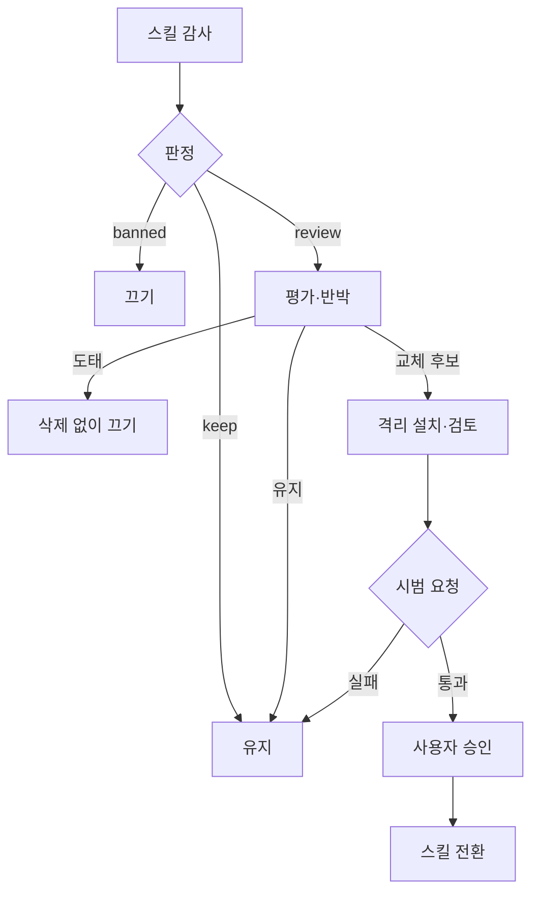

# 외부 스킬 수명 주기

`cx skills-audit`은 모든 스킬을 세 출처로 나눠 평가한다. 사용 신호와 성과는 아래 기준으로 확인한다. `<state>`는 `CONDUCTOR_HOME`, 없으면 `~/.codex/kp-conductor`다.



| 출처 | 대상 | 도태·교체 |
|---|---|---|
| external | 외부 저장소에서 설치한 스킬이다 | 아래 수명 주기를 따른다 |
| local | 출처 기록이 없는 직접 만든 스킬이다 | 지표만 본다 |
| native | Codex 시스템·플러그인 스킬이다 | 지표를 보고 개인 지도에 넣을지 정한다 |

`banned`는 `settings.json`의 `banned_skills`에 있는 스킬로만 판정한다.
목록은 fnmatch 패턴이며 기본값은 빈 목록이다.

conductor 자신은 평가하지 않는다. 지도나 역할 허용 목록에 있으면 사용 0회여도 review에서 제외한다. 감사 사유는 `reason routed`로 기록한다.

## 1. 감지

예약 회고가 `cx skills-audit`를 실행한다. 아래 조건을 모두 만족하는 external 스킬이 review 대상이다.

- 최근 30일 사용 횟수가 0이다.
- 로컬 수정이 30일 넘게 없다.

사용 횟수는 아래 값을 합한다.

- 사용자 직접 호출을 센다.
- 에이전트의 스킬 읽기를 센다.
- 연결된 MCP 호출을 센다.

review는 평가를 시작하는 신호다. 사용 0회를 결함 근거로 쓰지 않는다. 드물게 쓰지만 대체할 수 없는 스킬도 있기 때문이다.

review-duplicate는 이름이 같고 내용이 다른 사본이 둘 이상인 스킬이다. 두 SKILL.md를 비교하고 canonical_suggestion을 참고해 정본을 고른다. 다른 사본을 끄는 안을 `<state>/proposals/<날짜>.md`에 차이와 함께 적는다.

사용자가 승인하면 3절의 끄기 방법을 적용한다.

## 2. Council 평가

review 스킬마다 두 서브에이전트를 띄운다. 한 회고에서는 3개 스킬까지만 평가한다.

지시문 첫 줄은 `[conductor-subagent] [conductor-audit]`로 시작한다. 감사는 이 세션의 스킬 읽기를 사용 횟수에서 뺀다. 평가를 위한 읽기로 review가 풀리는 일을 막는다.

| 역할 | 평가 |
|---|---|
| cx-council | 공개 저장소와 설치 목록에서 같은 일을 하는 후보를 찾는다 |
| cx-review | 다른 공급사 검토자로서 Council의 결론을 반박한다 |

후보마다 아래 근거를 기록한다.

- 저장소 주소를 적는다.
- 최신 커밋을 적는다.
- 라이선스를 적는다.
- 스타 수를 적는다.
- 최근 커밋 날짜를 적는다.
- 실행 스크립트 유무를 적는다.

cx-review는 기존 스킬의 고유 기능을 확인한다. 사용자 직접 호출 이력과 후보의 요구 권한도 본다.

| 결론 | 의미 |
|---|---|
| 유지 | 기존 스킬을 유지한다 |
| 도태 | 기존 스킬을 끈다 |
| 교체: 저장소@커밋 | 고정 커밋의 후보를 검토한다 |

보고서는 `<state>/council/<날짜>-<스킬>.md`에 남긴다.

## 3. 적용

회고는 개인 설정만 고친다. config.toml 변경과 외부 스킬 설치·교체는 회고에서 제안만 남긴다. 아래 적용은 별도 스킬 관리 작업으로 수행한다.

maintainer 모드의 `retro.apply=notify`에는 예외가 있다. 회고가 도태와 금지 목록의 스킬을 바로 끈다. 절차는 [retrospective.md](retrospective.md)의 "스킬 끄기"다.

교체는 maintainer 모드에서도 아래 승인 절차를 따른다.

`cx backup`은 엔진 폴더와 Conductor 소유 단위를 보존한다.
소유 단위에는 개인 설정 파일과 생성 역할 파일이 들어간다.
Conductor 소유 역할 등록과 진입 블록도 들어간다.

`config.toml` 사본과 전역 `AGENTS.md` 사본도 보존한다.
백업 출력에서 보존 범위와 사본 위치를 확인한다.

**도태와 금지 목록의 스킬:** 알리고 바로 적용한다.
금지 목록은 `settings.json`의 `banned_skills`를 뜻한다.

1. `cx backup`을 실행한다.
2. `cx skills off <이름 또는 SKILL.md 경로>`를 실행한다. 스킬 파일은 지우지 않는다.

이 명령은 `~/.codex/config.toml` 끝의 Conductor 전용 구역에 아래 항목을 쓴다.
구역 밖의 설정은 바꾸지 않는다.

```toml
# conductor:skills:begin v1
[[skills.config]]
path = "<SKILL.md 경로>"
enabled = false
# conductor:skills:end
```

이름에 사본이 둘 이상이면 명령이 멈춘다. 그때는 SKILL.md 경로를 넘긴다.
`cx skills list`는 Conductor가 끈 스킬을 보여준다.

되돌리기 전에도 `cx backup`을 실행한다.
되돌리는 명령은 `cx skills on <같은 대상>`이다.

구역 밖에서 꺼진 스킬에 `cx skills on`을 하면 명령이 거절한다. 그 항목은 사용자가 직접 고친다.

**교체:** 마지막 전환 전에 사용자 한 줄 승인을 받는다. 설치된 지시와 스크립트의 권한을 먼저 검토한다.

1. 고정 커밋의 후보를 `<state>/staging/<이름>`에 내려받는다.
2. cx-review가 모든 파일을 읽기 전용으로 검토한다. 아래 권한과 동작을 찾는다.
   - 네트워크 호출을 확인한다.
   - 파일 삭제를 확인한다.
   - 권한 상승을 확인한다.
   - 인증 정보 접근을 확인한다.
3. `cx backup` 뒤 꺼진 상태로 설치한다. 해당 스킬을 쓰는 요청을 새 세션에서 돌린다.
4. 대체 대상과 후보 저장소·커밋에 검토 결과를 붙여 사용자 승인을 받는다.
5. 승인되면 `cx backup`을 실행한다. 새 스킬을 켜고 기존 스킬을 끈다. 출처·커밋은 `<state>/skills-installed.json`에 적는다.

## 4. 기록

적용마다 `cx receipt --type D --model <검토 모델> --effort high --outcome pass|fail --run single`를 남긴다. 다음 주간 감사가 결과를 다시 확인한다.
